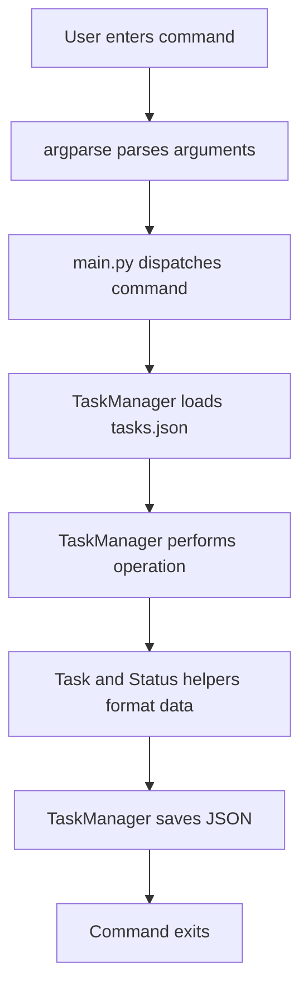

   

# todoCLI

A lightweight command-line task manager written in Python. todoCLI lets you create tasks, inspect them, change their workflow status, and remove individual tasks or groups of tasks from a terminal.

The project is intentionally small: it uses Python's standard library, a command-line interface built with `argparse`, simple task and status models, and JSON-file persistence. It is suitable for learning how a small CLI application can separate argument parsing, domain objects, task operations, and persistence.

> **Current implementation note:** Tasks are stored in a local `tasks.json` file in the process working directory. This is a local, single-user utility, not a hosted or multi-user task service.

## Contents

- [What it does](#what-it-does)
- [Current capabilities](#current-capabilities)
- [Technology](#technology)
- [Project structure](#project-structure)
- [Requirements and installation](#requirements-and-installation)
- [Running the application](#running-the-application)
- [Command reference](#command-reference)
- [Task status model](#task-status-model)
- [Data storage and persistence](#data-storage-and-persistence)
- [How the application works](#how-the-application-works)
- [Limitations and operational considerations](#limitations-and-operational-considerations)
- [Troubleshooting](#troubleshooting)
- [Development and contribution](#development-and-contribution)

## What it does

todoCLI manages a small list of tasks from the terminal. Each task has a numeric identifier, a title, and a status. The command interface exposes five operations:

1. Add a task.
2. List all tasks or a filtered subset.
3. Update the status of a task or a group of tasks.
4. Delete a task or a group of tasks.
5. Display the supported status values.

The command parser is implemented with Python's built-in `argparse` module. Task state is represented by Python objects and serialized as JSON when the command finishes.

## Current capabilities

| Capability | Current behavior |
|---|---|
| Create tasks | Adds a task with a title and optional numeric status |
| List tasks | Lists all tasks, or filters by status and/or ID range |
| Update status | Changes one task or a selected group to a new status |
| Delete tasks | Removes one task, tasks matching a status, or tasks in an ID range |
| Status help | Prints the three built-in workflow states |
| Persistence | Reads and writes a local JSON file named `tasks.json` |

The implementation is deliberately transparent. It does not currently provide due dates, priorities, tags, projects, reminders, recurring tasks, cloud synchronization, user accounts, or a graphical interface. Those should be treated as possible future extensions, not existing features.

## Technology

- **Python:** application language.
- **argparse:** command-line parsing and generated help.
- **JSON:** local task serialization.
- **pathlib:** checking whether the data file exists.
- **enum:** defining the available task statuses.

No third-party Python package is required by the current source files.

## Project structure

```text
todoCLI/
├── src/
│   ├── main.py           # CLI parser and command dispatch
│   ├── task.py           # Task model and display/serialization helpers
│   ├── status.py         # Status enum and status label conversion
│   └── task_manager.py   # In-memory collection and JSON persistence
├── images/               # Repository image assets, if used
├── .gitignore
├── README.md
└── tasks.json            # Created at runtime in the working directory
```

The exact location of `tasks.json` depends on the directory from which the program is launched, because the current implementation uses the relative path `tasks.json`.

## Requirements and installation

### Requirements

- Python 3.9 or later is a sensible baseline for a modern environment. The code uses standard-library features and does not declare a third-party dependency file.
- A terminal or command prompt.
- Git, if you want to clone the repository.

### Clone the repository

```bash
git clone https://github.com/Brajesh31/todoCLI.git
cd todoCLI
```

### Run without installing a package

The entry point is `src/main.py`. Because the modules import each other by their local module names, run it with the source directory as the working directory:

```bash
cd src
python main.py --help
```

This approach ensures imports such as `from task_manager import TaskManager` resolve from the same directory.

## Running the application

From the `src` directory:

```bash
python main.py add "Prepare project documentation"
python main.py list
python main.py status
```

The first invocation that saves data creates `tasks.json` in the current working directory. Run subsequent commands from the same directory to work with the same data file.

To see the authoritative command syntax for the current version, use:

```bash
python main.py --help
python main.py add --help
python main.py del --help
python main.py upd --help
python main.py list --help
```

## Command reference

### Add a task

```bash
python main.py add "Write the release notes"
python main.py add "Review pull requests" 2
```

The optional second argument is a numeric status. If omitted, the parser supplies status `1` (New).

### List tasks

```bash
python main.py list
python main.py list --status 1
python main.py list --range 1 5
python main.py list --range 1 10 --status 2
```

A range is passed as two integer bounds. The current implementation checks whether each task ID is contained in the supplied Python range object. Python ranges exclude the end value, so the second bound behaves as an exclusive endpoint in the current code. For example, `--range 1 5` selects IDs 1 through 4, not 1 through 5.

### Update task status

```bash
python main.py upd 1 2
python main.py upd --range 1 5 3
python main.py upd --status_from 1 2
```

The first form changes task 1 to status 2. The second applies status 3 to IDs selected by the range. The third selects tasks currently in status 1 and changes them to status 2.

### Delete tasks

```bash
python main.py del 1
python main.py del --status 3
python main.py del --range 1 5
```

Deletion is permanent for the local JSON data file once the command saves successfully. Consider copying `tasks.json` before bulk deletion if the data matters.

### Show statuses

```bash
python main.py status
```

## Task status model

The current application defines three numeric statuses:

| Value | Label | Meaning |
|---:|---|---|
| 1 | New | Task has been captured but work has not started |
| 2 | In Progress | Work is underway |
| 3 | Done | Task is considered complete |

The values are defined in `src/status.py`. The CLI currently accepts integers rather than textual labels. A status outside the three defined values may be stored, but the display helper does not provide a meaningful label for an unknown value. Use only 1, 2, and 3 unless the implementation is deliberately extended.

## Data storage and persistence

The task manager loads `tasks.json` when it starts, converts each JSON object into a `Task` instance, and computes the next task number from the highest existing ID. When the command finishes, the manager serializes its in-memory task collection back to JSON with indentation.

A task record has this shape:

```json
{
  "num": 1,
  "title": "Prepare project documentation",
  "status": 1
}
```

Important behavior to understand:

- The file is local to the current working directory.
- The complete task collection is rewritten on save.
- IDs are assigned from the highest ID currently present plus one.
- Deleting the highest-numbered task does not necessarily reuse its identifier if other higher IDs remain; if all tasks are removed, the next ID returns to 1 on the next run.
- There is no locking or concurrency control. Running multiple instances against the same file can cause lost updates.
- The current implementation does not include a migration/version field in the JSON format.

## How the application works

The application follows a simple layered flow:



- `main.py` owns command definitions and dispatch. It should remain focused on translating terminal arguments into manager method calls.
- `TaskManager` owns the collection, filtering, ID assignment, and persistence.
- `Task` represents one record and exposes display and dictionary-conversion behavior.
- `Status` centralizes the supported status values and their human-readable labels.

## Limitations and operational considerations

This repository is a compact local utility. Before relying on it for important data, be aware of the following current implementation constraints:

1. **Relative storage path:** the data file is created in the current working directory, not necessarily beside the source files.
2. **No file locking:** simultaneous processes can overwrite each other's changes.
3. **No validation layer:** task titles and status values receive limited validation.
4. **Range endpoint behavior:** Python's range endpoint is exclusive, which may surprise users expecting an inclusive end ID.
5. **Error handling:** malformed JSON, permission failures, and invalid input can surface as exceptions.
6. **No automated test suite is declared:** changes should be checked manually until dedicated tests are added.
7. **No packaging metadata:** there is no declared console-script installation command at present.

These are documented constraints, not claims that the application already solves them.

## Troubleshooting

**The command says a module cannot be found.** Run the script from inside `src`, as shown above, so the local imports resolve.

**My tasks appear to have disappeared.** Check the directory from which the command was launched. A different working directory can create or read a different `tasks.json`.

**A status label is blank.** The stored numeric value is not one of the three mapped values. Use 1, 2, or 3.

**A range omits the last ID.** The current range implementation follows Python's exclusive end behavior. For an inclusive desired upper ID, the supplied endpoint must be one greater.

**The JSON file cannot be read.** Check that it contains valid JSON and that the current user has read/write permission. Make a backup before manually repairing it.

## Development and contribution

Keep changes small and aligned with the existing separation of responsibilities. Add or update tests when changing parsing, range semantics, ID allocation, filtering, or serialization. See [CONTRIBUTING.md](CONTRIBUTING.md) for the development workflow and [docs/ARCHITECTURE.md](docs/ARCHITECTURE.md) for the component boundaries.

## License

This repository is distributed under the MIT License. See [LICENSE](LICENSE) for the complete terms.


## Documentation library

- [User guide](docs/USER_GUIDE.md): command usage, examples, task management, and troubleshooting.
- [Data format](docs/DATA_FORMAT.md): JSON schema, status values, identifiers, and persistence behavior.
- [Architecture](docs/ARCHITECTURE.md): module boundaries and runtime flow.
- [Development guide](docs/DEVELOPMENT.md): local workflow and verification strategy.
- [Contributing](CONTRIBUTING.md) and [security policy](SECURITY.md).
- [Community guidelines](CODE_OF_CONDUCT.md).

Last updated: 2026-11-13 21:26 UTC
