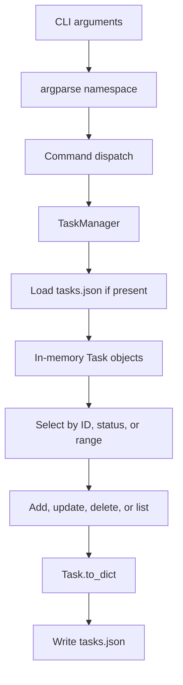

# todoCLI Architecture

## 1. Purpose and scope

This document describes the architecture of the current todoCLI implementation. It is intended for maintainers and contributors who need to understand where command-line behavior, task state, filtering, status labels, and persistence belong.

todoCLI is a small, synchronous, single-user command-line application. Its architecture is intentionally modest. It does not use a web server, database server, ORM, background worker, or external task-management service.

## 2. Architectural overview

The application has four primary modules:

| Module | Responsibility | Should not become responsible for |
|---|---|---|
| `main.py` | Parse CLI arguments and dispatch the requested operation | JSON file parsing and task collection internals |
| `task_manager.py` | Own task collection, ID allocation, filtering, mutations, and persistence | Terminal argument syntax |
| `task.py` | Represent a task and convert it to/from display or dictionary form | Choosing CLI commands |
| `status.py` | Define status values and map values to display labels | Persisting tasks or parsing arguments |

## 3. Runtime lifecycle

1. The Python interpreter loads the entry-point module.
2. `setup()` builds the argument parser and requires a subcommand.
3. `parse_args()` converts terminal tokens into a namespace.
4. `TaskManager()` initializes an empty collection, then loads `tasks.json` if the file exists.
5. The selected command calls the corresponding manager method.
6. `save()` serializes the current collection to JSON.
7. The process exits.

The save call currently occurs after command dispatch for every recognized command, including read-only commands. This is simple and predictable, although a future design could avoid rewriting the file for commands that do not mutate state.

## 4. Component details

### 4.1 CLI boundary: `src/main.py`

The CLI module declares the public command vocabulary:

- `add`: create a task.
- `del`: delete a task or a selection.
- `upd`: update status.
- `list`: print tasks.
- `status`: print supported status values.

The parser uses subparsers and typed integer arguments. The command dispatcher translates the parsed namespace into method calls. Keep user-facing argument names, defaults, help text, and command dispatch here.

A future CLI improvement should validate incompatible argument combinations before invoking the manager. For example, deletion by a single ID, status, and range are alternative selection modes and should have an explicitly documented precedence or mutually exclusive parser group.

### 4.2 Domain model: `src/task.py`

A task contains three fields:

- `num`: numeric task identifier.
- `title`: task title.
- `status`: numeric workflow status.

The model can print itself using the status-label helper, update its status, and serialize to a dictionary. The JSON dictionary keys currently match constructor argument names, which is why the manager can reconstruct objects using keyword expansion.

When extending the model, preserve compatibility with existing JSON records or introduce a deliberate migration strategy.

### 4.3 Status vocabulary: `src/status.py`

The `Status` enum defines New (1), InProgress (2), and Done (3). The `to_string` function converts a numeric value to a padded label. Unknown values currently map to an empty string. This means status validation is important at the CLI or manager boundary if the project wants to guarantee that all persisted records display correctly.

### 4.4 Collection and persistence: `src/task_manager.py`

The manager owns the in-memory list and the next ID counter. On startup it loads JSON records, reconstructs task objects, and sets the next ID to one greater than the maximum ID.

Filtering is performed by helper functions:

- `find` returns the first task with a matching ID.
- `filter_status` selects tasks with an exact status value.
- `filter_range` selects IDs contained in a Python range.

The shared `task_with_op` method applies a callback to the selected tasks. Delete and update use this helper to avoid duplicating selection logic. Listing follows similar filtering branches but prints the selected records.

## 5. Data flow and persistence model

The file format is a JSON array. Each element represents one task. The manager rewrites the full array during save. This is appropriate for a small local collection, but it is not designed for concurrent writers or very large datasets.

## 6. Important implementation semantics

### 6.1 Range boundaries

The current helper uses Python's `range(start, end)` semantics. The end is exclusive. A user who expects inclusive bounds may find this surprising. Documentation must describe the existing behavior accurately. A future change to inclusive bounds should include tests and a clear compatibility note.

### 6.2 ID allocation

IDs are derived from the maximum ID in the loaded collection. This avoids collisions in a single process with one data file. It does not provide globally unique IDs across concurrent processes.

### 6.3 Relative file location

`DATA_FILE` is the relative path `tasks.json`. The file is resolved relative to the process working directory. This is an observable part of the current behavior and should not be described as being stored next to `task_manager.py`.

### 6.4 Save behavior

The CLI calls `save()` after dispatch. Serialization uses indentation for readability. The current implementation does not use a temporary file plus atomic rename, does not lock the file, and does not preserve a previous version automatically.

## 7. Error boundaries

The current code has limited explicit error handling. Potential failure points include:

- JSON decoding when the file is malformed.
- File permission or disk errors during read/write.
- Invalid numeric status values.
- Unexpected command argument combinations.
- Missing or malformed task fields in manually edited JSON.

Contributors should not document these cases as handled unless code and tests are added to support that claim.

## 8. Testing strategy for future changes

A robust test suite should cover the following layers independently:

1. **Status tests:** valid enum values and unknown-value behavior.
2. **Task tests:** construction, status update, printed representation, and dictionary serialization.
3. **Manager tests:** empty startup, loading existing JSON, next-ID calculation, add, delete, update, filtering, and persistence.
4. **CLI tests:** help output, required subcommands, optional status defaults, and command dispatch.
5. **Boundary tests:** empty collection, unknown task ID, malformed JSON, invalid status, and range endpoints.

Use temporary directories for persistence tests so tests never modify a developer's real `tasks.json`.

## 9. Safe extension points

Potential future improvements should be introduced at the appropriate layer:

- Status validation: CLI boundary and manager boundary.
- Inclusive range behavior: selection helpers and CLI documentation.
- Custom data path: configuration or manager constructor.
- Atomic writes: persistence implementation.
- Search by title: manager selection helpers and CLI parser.
- Due dates or priorities: task model, serialization, migration, and CLI.
- Packaging as an installable command: project metadata and entry-point configuration.

Do not add these capabilities only to the documentation. Documentation must describe shipped behavior, while proposals belong in an explicitly labeled roadmap.

## 10. Maintenance rule

When changing a public command, data shape, status value, range rule, or persistence location, update the README command reference and this architecture document in the same change. Include tests for behavior changes and describe any migration required for existing JSON files.
